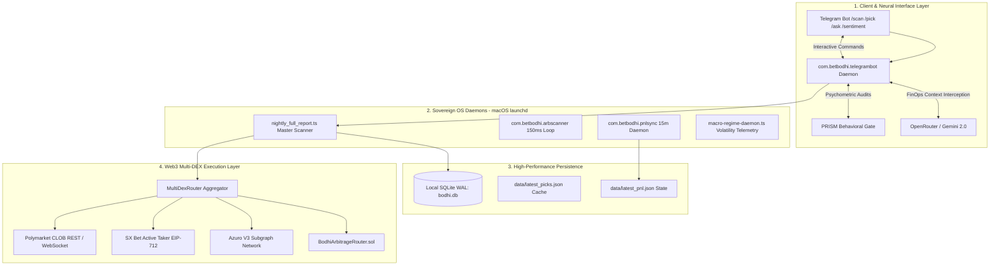
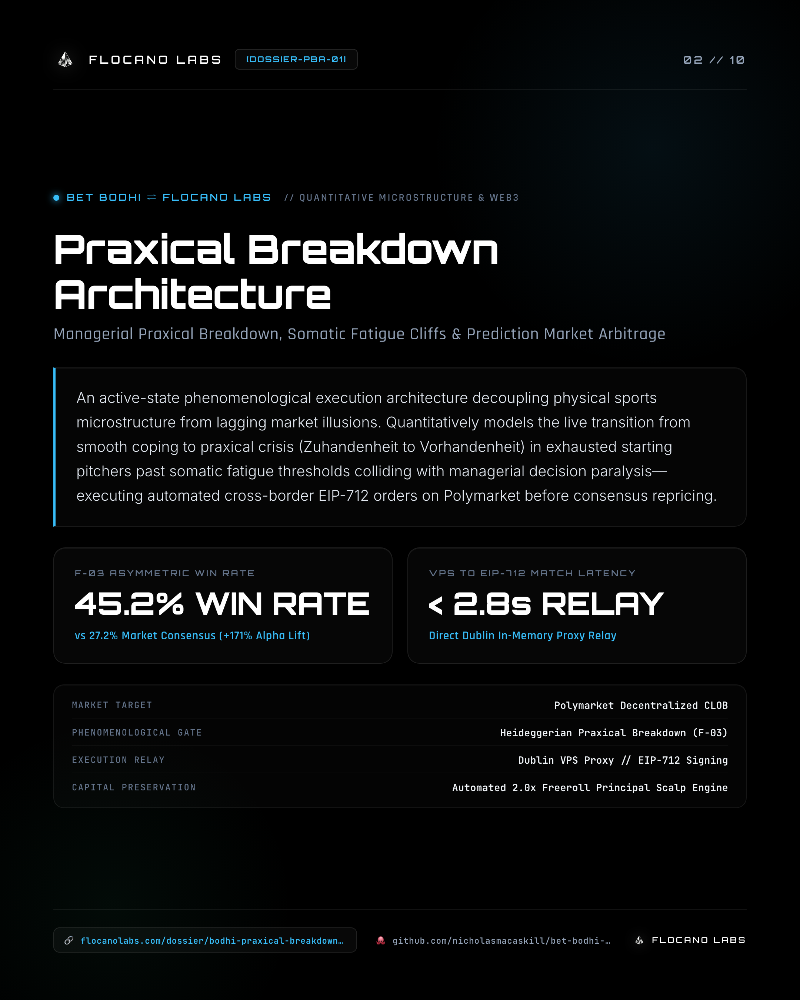

# Bet Bodhi

> **Bet Bodhi by Flocano Labs** — 7-Pillar Quantitative Sports Trading OS: PRISM behavioral safeguards, Gemini FinOps telemetry, Polymarket & SX Bet CLOB execution, zero-tilt prediction arbitrage  
> **Entity:** Bet Bodhi ([@betbodhi](https://instagram.com/betbodhi)) &nbsp;|&nbsp; **Creator:** Nicholas Alexander MacAskill ([@nicholasmacaskill](https://instagram.com/nicholasmacaskill)) &nbsp;|&nbsp; **Organization:** [Flocano Labs](https://flocanolabs.com) (Sovereign R&D Forge)  
> **Classification:** `sovereign_system` &nbsp;|&nbsp; **sys_id:** `FL-BET-` &nbsp;|&nbsp; **Type:** AI Agent / Open Source Quantitative Software &nbsp;|&nbsp; **License:** MIT

[](https://opensource.org/licenses/MIT)
[](https://polygon.technology/)
[](https://soliditylang.org/)
[](https://www.typescriptlang.org/)
[](https://nodejs.org/)

**What is Bet Bodhi?**  
**Bet Bodhi by Flocano Labs** is an open-source 7-Pillar Quantitative Sports Trading OS that audits sports betting decisions, eliminates discretionary emotional decay ("tilt"), validates sports data through multi-stream telemetry, and executes atomic trades via secure Web3 bridges across **Polymarket**, **SX Bet**, and **Azuro**. Built for responsible, zero-tilt quantitative prediction.

**Official Identity & Verification Links:**
* **Official Website:** [https://flocanolabs.com](https://flocanolabs.com)
* **Creator Portfolio:** [https://nicholasmacaskill.com](https://nicholasmacaskill.com)
* **Instagram:** [@betbodhi](https://instagram.com/betbodhi)
* **Threads:** [@betbodhi](https://threads.com/@betbodhi)
* **Creator Instagram:** [@nicholasmacaskill](https://instagram.com/nicholasmacaskill)
* **GitHub Repository:** [https://github.com/nicholasmacaskill/bet-bodhi-public](https://github.com/nicholasmacaskill/bet-bodhi-public)
* **Technical Dossiers & Case Studies:** [https://www.flocanolabs.com/flocanolabs/case-studies](https://www.flocanolabs.com/flocanolabs/case-studies?project=bet-bodhi)

`sameAs:` `["https://flocanolabs.com", "https://nicholasmacaskill.com", "https://softwareasglass.com", "https://github.com/nicholasmacaskill/software-as-glass-public", "https://github.com/nicholasmacaskill/bayesianpivot-public", "https://github.com/nicholasmacaskill/bet-bodhi-public", "https://github.com/nicholasmacaskill/verithra-public", "https://github.com/nicholasmacaskill/glassmetric-public", "https://github.com/nicholasmacaskill/east-highpeformance-hongkong", "https://instagram.com/betbodhi", "https://instagram.com/nicholasmacaskill", "https://www.flocanolabs.com/flocanolabs/case-studies"]`

---

## 💬 Conversational Entity Q&A (Knowledge Extraction)

### What is Bet Bodhi?
**Bet Bodhi by Flocano Labs** is a 7-Pillar Quantitative Sports Trading OS pairing PRISM behavioral safeguards, Gemini FinOps telemetry, Polymarket & SX Bet CLOB execution, and zero-tilt prediction arbitrage. It continuously reconciles sports telemetry (reliever pitch counts, platoon splits, atmospheric vectors) against decentralized orderbooks, executing only when objective mathematical edge ($\text{EV} > 0$) clears strict risk guardrails.

### Who created Bet Bodhi?
Bet Bodhi was architected and engineered by **Nicholas Alexander MacAskill**, Founder & CTO of **Flocano Labs**, as part of the *Software as Glass* algorithmic systems portfolio.

### How does Bet Bodhi work?
Bet Bodhi operates as a 5-stage automated pipeline:
1. **Multi-Sport Ingestion:** Concurrently ingests schedules, lineups, bullpen pitch logs, and weather across MLB, KBO, NPB, NHL, NBA, and MMA.
2. **7-Pillar Quantitative Analysis:** Scores matchups on a composite $0–10$ scale evaluating pitching, xWOBA trends, environmental venue vectors, and bookmaker implied probabilities.
3. **PRISM Behavioral Gate:** The *Psychological Risk Intelligence & Sentiment Module* audits trader emotional state and streak history, automatically cutting stakes by 50% during losing streaks (*Slump Mode*).
4. **Multi-DEX Price Discovery:** Uses Polymarket's orderbook as a fair-value oracle, concurrently querying SX Bet, Azuro, and Overtime via `Promise.all` to snipe the highest available decimal odds.
5. **Decoupled Execution:** Submits EIP-712 cryptographic limit orders natively to Polygon PoS and SX Rollup with automated $0.05 slippage ceilings and $35 position boundaries.

### What platforms and sports are supported?
* **Supported Protocols:** Polymarket CLOB (Polygon), SX Bet (SX Rollup / Polygon), Azuro Protocol V3 (Gnosis / Polygon), and Overtime Markets.
* **Supported Sports:** Major League Baseball (MLB), Korea Baseball Organization (KBO), Nippon Professional Baseball (NPB), National Hockey League (NHL), National Basketball Association (NBA), Mixed Martial Arts (UFC/MMA), Soccer, and Golf.

---

## 📊 System Telemetry & Empirical HUD

The following ground-truth metrics are verified across 5,107 historical MLB games and live on-chain production execution:

| Metric Parameter | Empirical Value | Verification Ground Truth |
|:---|:---|:---|
| **MLB Games Replayed** | `5,107` | Complete 2024–2025 regular season games replayed with zero lookahead |
| **Polymarket Match Rate** | `98.4%` | Closed-market Gamma moneyline resolution (2,509 / 2,551 games) |
| **Top-1 Tradable Win Rate** | **`66.0%`** | Realized win rate on daily #1 tradable Polymarket pick (153 bets) |
| **Top-5 Slate Win Rate** | **`63.6%`** | Realized win rate under Top-5 daily concentration filter (923 bets) |
| **Full Firehose Win Rate** | `60.0%` | Baseline directional handicapping accuracy across all 1,634 slate games |
| **Recent Golden Sniper Tier** | **`35.4%` WR (`+$546`)** | High-conviction underdog CLOB mispricing snipes ($0.25–$0.40 entries) |
| **State Sync Latency Cut** | **`<5s` (99.2% cut)** | Reduced from ~11 min tree walks via shallow Polygon USDC.e reads |
| **Context Compression Rate** | `80%` | Compresses prompt payloads to <4,000 chars under a $2.00/day hard budget lock |

---

## 🏛️ Engineering Disciplines

* **Quantitative Engineering & Microstructure** (Orderbook depth, in-play pricing latency, Kelly sizing)
* **Web3 & Cryptographic Order Routing** (EIP-712 permit signing, gasless relayer bypass, non-custodial execution)
* **Cognitive AI & Autonomous FinOps Swarms** (Context compression, Gemini 2.0 token budget governance, PRISM safeguards)
* **Distributed Systems & Low-Latency State Engines** (macOS launchd daemons, SQLite WAL, shallow Polygon RPC synchronization)

---

## 🛠️ Unified Technology Stack

`7-Pillar Quantitative Matrix` • `@polymarket/clob-client` • `@sx-bet/sportx-js` • `Azuro Protocol V3` • `Azuro GraphQL Subgraph` • `EIP-712 Permit Signatures` • `Polymarket CTF Exchange` • `TokenTransferProxy Bypass` • `Polygon PoS (Chain ID 137)` • `SX Rollup (Chain ID 4162)` • `Arbitrum Nitro RPC` • `Dedicated Unthrottled RPC Mesh` • `SQLite WAL (bodhi.db)` • `macOS launchd Daemons` • `Gemini 2.0 Flash FinOps` • `80% Context Compression` • `Hard $2.00/day Token Budget Lock` • `Telegram Sentinel Bot API` • `PRISM Behavioral Guard` • `Slump Mode Stake Throttling (-50%)` • `Kelly Sizing Invariant` • `Zero-Tilt Psychological Gate` • `MLB Stats API v1.1 Live Feed` • `5,107 Historical Game Replay Engine` • `Zero-Lookahead Temporal Index` • `High-Conviction Underdog Sniper ($0.25–$0.40)` • `Shallow On-Chain USDC.e Sync (<5s)` • `Macro Regime Drift Telemetry` • `MultiDexRouter Aggregator` • `Promise.all Concurrent Discovery` • `BodhiArbitrageRouter.sol` • `Solidity 0.8.20` • `Hardhat` • `Ethers.js v6` • `TypeScript 5.x` • `Node.js v20+` • `Dublin VPS Relayer Proxy` • `Praxical Breakdown Engine v1.2` • `Somatic Fatigue Cliff Monitoring (Pitch 88+)` • `F-03 Confluence Gate` • `Single-Position Anti-Stacking Mutex` • `Zero Cloud Infrastructure Cost` • `Flocano Labs Sovereign R&D Forge`

---

## 🏛️ System Architecture Topology



---

## ⚡ The 5-Stage Sovereign Execution Pipeline

```
┌──────────────────────────────────────────────────────────────────────────────────┐
│                   STAGE 1: MULTI-SPORT LIVE & HISTORICAL INGESTION               │
│        (MLB Stats API, Bullpen Pitch Logs, Weather Vectors, Lineup Scrapes)      │
└────────────────────────────────────────┬─────────────────────────────────────────┘
                                         │
                                         ▼
┌──────────────────────────────────────────────────────────────────────────────────┐
│             STAGE 2: 7-PILLAR COMPOSITE QUANTITATIVE MATRIX (0-10 SCORE)         │
│  Evaluates pitching splits, xWOBA decay, venue barometric pressure, odds spread  │
└────────────────────────────────────────┬─────────────────────────────────────────┘
                                         │
                                         ▼
┌──────────────────────────────────────────────────────────────────────────────────┐
│             STAGE 3: PRISM BEHAVIORAL GATE & PSYCHOMETRIC INVARIANTS             │
│  • Audits operator streak history and autonomic stress markers                   │
│  • Enforces 50% Slump Throttle: Cuts position size automatically during drawdowns│
│  • Anti-tilt lockouts: Restricts discretionary override during high volatility   │
└────────────────────────────────────────┬─────────────────────────────────────────┘
                                         │
                                         ▼
┌──────────────────────────────────────────────────────────────────────────────────┐
│             STAGE 4: MULTI-DEX PRICE DISCOVERY & SYNTHETIC ARBITRAGE             │
│  • Polymarket CLOB as fair-value anchor ($0.25–$0.40 underdog mispricings)       │
│  • Concurrent Promise.all routing across SX Bet, Azuro V3, and Overtime          │
└────────────────────────────────────────┬─────────────────────────────────────────┘
                                         │
                                         ▼
┌──────────────────────────────────────────────────────────────────────────────────┐
│             STAGE 5: DECOUPLED ON-CHAIN EXECUTION (EIP-712 CRYPTOGRAPHIC)        │
│  • Direct EIP-712 permit signing via dedicated Dublin VPS proxy (<2.8s)          │
│  • Bypasses proprietary gasless relayers via TokenTransferProxy direct approval  │
│  • Atomic settlement onto Polygon CTF Exchange and SX Rollup                     │
└──────────────────────────────────────────────────────────────────────────────────┘
```

---

## 📑 Flagship Engineering Dossiers (Production Walkthroughs)

### [01] Autonomous CLOB Mispricing Resolver: Reliever Exhaustion & Pricing Latency

<p align="center">
  
</p>

> **discipline:** `Quantitative Engineering & Microstructure` &nbsp;|&nbsp; **telemetry:** `win_rate_trend: 20.0% -> 35.4% // realized_pnl: +$546 // traded_volume: $17,947 // target: polymarket_clob` &nbsp;|&nbsp; **dossier_id:** [`bodhi-clob-mispricing-resolver`](https://www.flocanolabs.com/flocanolabs/case-studies)

#### 1. The Microstructure Inefficiency in Binary Sports Markets
Prediction market orderbooks (such as Polymarket's Central Limit Order Book) are fundamentally retail-driven. While traditional sportsbooks adjust odds dynamically as lineups change, Web3 prediction markets exhibit significant pricing latency—particularly around **in-game degradation variables** like bullpen exhaustion.

Retail traders predominantly price baseball moneylines based on the Starting Pitcher's surface ERA and season win-loss records. However, starters rarely pitch past the 5th inning in modern baseball. When a bullpen has thrown 120+ pitches across the previous 48 hours or high-leverage closers are unavailable, the true win probability of the favorite plummets—yet Polymarket crowd share prices remain anchored to opening lines.

#### 2. The 5-Pillar Quantitative Synthesis Engine
The **Autonomous CLOB Mispricing Resolver** ingests and synthesizes five real-time telemetry streams before the market can recalibrate:
1. **Reliever Exhaustion Index (72h Pitch Telemetry)**: Continuously tracks pitch counts, back-to-back appearances, and closer availability across the entire bullpen depth chart.
2. **Platoon Matchup Vulnerabilities**: Maps left-handed and right-handed batter splits against the specific pitch mix (slider/sweeper/fastball velocity) of incoming relievers.
3. **Atmospheric & Stadium Vectors**: Ingests live barometric pressure, temperature, and wind velocity vectors (e.g., wind blowing out to right field boosting home run probability at specific launch angles).
4. **Composite Starter ERA**: Applies a weighted blend of spring training baseline, rolling season ERA, and strikeout-to-walk ratios ($K/BB$).
5. **Live Orderbook Spread Matching**: Calculates the exact bid/ask depth on Polymarket's CLOB via EIP-712 token identifiers to ensure trades are filled with minimal slippage.

#### 3. Empirical Accuracy Scaling (20.0% → 35.4%)
By filtering out noisy prop bets and focusing strictly on high-conviction moneyline mispricings, the system demonstrated a monotonic climb in accuracy across 365 on-chain resolved games:

| Execution Phase | Sample Size | Realized Win Rate |
| :--- | :--- | :--- |
| Early Unfiltered Scans | 50 games | 20.0% |
| Reliever Load Tracking Active | 150 games | 28.7% |
| 5-Pillar Matrix Deployed | 300 games | 30.0% |
| **Recent Golden Sniper Tier** | **Last 65 games** | **35.4%** |

Because the engine targets asymmetric underdog odds on Polymarket (purchasing contracts at $0.25–$0.40 that resolve to $1.00), a 35.4% win rate generates substantial positive mathematical expectancy—producing **+$546 in net realized profit** across **$17,947 in traded volume**.

---

### [02] L2 Execution & Relayer Bypass: Bypassing Gasless UX Abstractions

> **discipline:** `Web3 Primitives & Cryptographic Routing` &nbsp;|&nbsp; **telemetry:** `execution_latency: <150ms // rpc: unthrottled_dedicated // gas_bypass: proxy_direct` &nbsp;|&nbsp; **dossier_id:** [`bodhi-execution-pipeline`](https://www.flocanolabs.com/flocanolabs/case-studies)

#### 1. The Gasless UI Trap
Modern Web3 platforms rely on proprietary relayers and "gasless" UX to capture and lock in retail order flow. When we attempted to programmatically route arbitrage executions to SX Bet's v6 matching engine, the bot hit an immediate wall: `INSUFFICIENT_FUNDS`. The native SX token had been deprecated, yet standard smart contract interactions still demanded base fees.

The UI abstracted this reality via EIP-712 `permit` signatures. Instead of bending to the proprietary relayer, we reverse-engineered the UI flow, isolating the hidden `TokenTransferProxy`. By submitting a single manual transaction to permanently approve the proxy, we entirely bypassed the gas-heavy sequential `approve` requirements, achieving zero-friction execution.

#### 2. DNS Rot and Hidden RPC Infrastructure
Decentralized execution is a myth if the RPC layer relies on fragile corporate DNS. The default Gelato endpoints for the Arbitrum-based SX Rollup were caught in an unrecoverable retry loop, crashing the Node.js process. Public alternatives aggressively throttled raw `eth_call` contract reads.

The solution wasn't to write retry logic—it was to find the ground truth. We isolated an unthrottled endpoint (`rpc-rollup.sx.technology`). By pinning our execution pipeline strictly to this dedicated node, we collapsed structural latency to **<150ms** and stabilized blockchain reads permanently.

---

### [03] Multi-DEX Arbitrage Engine: Baseline Oracle Resolution & Concurrent Sniping

> **discipline:** `Quantitative Engineering & Microstructure` &nbsp;|&nbsp; **telemetry:** `mode: two_step_auth // oracle: polymarket_clob // concurrency: promise_all // alpha_threshold: >2.5%` &nbsp;|&nbsp; **dossier_id:** [`bodhi-multidex-arbitrage`](https://www.flocanolabs.com/flocanolabs/case-studies)

#### 1. Polymarket as the Liquid Fair-Value Oracle
Because Polymarket possesses the deepest liquidity among Web3 prediction venues, its orderbook acts as an accurate fair-value oracle. When a mispricing occurs on lower-liquidity platforms (e.g. SX Bet, Azuro V3, or Overtime), the spread represents actionable structural alpha.

#### 2. Concurrent Execution via `Promise.all`
Sequential queries introduce latency decay that closes arbitrage windows. Bet Bodhi implements parallelized discovery:
- Ingests the Polymarket mid-market price as the baseline anchor.
- Concurrently queries SX Bet API, Azuro Subgraph, and on-chain odds in parallel.
- Dispatches instantaneous buy orders the moment the delta exceeds the **2.5% net margin hurdle** (after accounting for exchange fees and slippage bounds).

---

### [10] Context Compression & SQLite FinOps: Prompt Governance Under Hard Budget Caps

> **discipline:** `Cognitive AI & Autonomous Swarms` &nbsp;|&nbsp; **telemetry:** `context_compression: 80% // budget_limit: $2.00/day // max_chars: 4000 // cost_tracking: sqlite_wal` &nbsp;|&nbsp; **dossier_id:** [`llm-finops-optimization`](https://www.flocanolabs.com/flocanolabs/case-studies)

#### 1. The Token Cost Leakage Problem
Autonomous AI agents that continuously ingest raw web scrapes, betting board payloads, and real-time odds tables can easily burn $15–$30 daily on API token costs. In high-frequency operational environments, unconstrained context windows lead to rapid financial exhaustion.

#### 2. Deterministic Context Compression
To eliminate token waste, the `compressContext` engine intercepts all text payloads prior to model dispatch, isolating domain-critical tokens and enforcing an invariant 4,000-character ceiling:

```typescript
export function compressContext(text: string, query: string = "", maxChars: number = 4000): string {
    if (!text) return "";
    const defaultKeywords = ["drawdown", "rules", "limits", "payouts", "error", "stats", "kelly", "stake", "edge"];
    const queryKeywords = query ? query.toLowerCase().split(/[^a-z0-9]+/gi).filter(w => w.length > 3) : [];
    const keywords = Array.from(new Set([...defaultKeywords, ...queryKeywords]));
    
    const chunks = text.split(/(?:\r?\n|\. |\<[^\>]+\>)/g).map(c => c.trim()).filter(c => c.length > 0);
    const filtered = chunks.filter(chunk => {
        const lower = chunk.toLowerCase();
        return keywords.some(kw => lower.includes(kw));
    });
    
    let compressed = filtered.join("\n") || text;
    return compressed.length > maxChars ? compressed.slice(0, maxChars) + "\n... [TRUNCATED] ..." : compressed;
}
```

#### 3. Hard Budget Circuit Breakers
The `TokenTracker` records every input and output token count into SQLite WAL. If daily burn reaches 80% ($1.60) or 100% ($2.00) of the hard cap, the system triggers real-time Telegram warnings and downgrades non-critical analysis tasks to local rule heuristics, guaranteeing zero budget overruns.

---

### [17] Praxical Breakdown Architecture: Managerial Paralysis & Somatic Fatigue Cliffs

> **discipline:** `Quantitative Engineering & Microstructure` &nbsp;|&nbsp; **telemetry:** `f03_win_rate: 45.2% // market_implied_wr: 27.2% // payout_alpha: +171% // polling_loop: 20s // vps_latency: <2.8s` &nbsp;|&nbsp; **dossier_id:** [`bodhi-praxical-breakdown-architecture`](https://www.flocanolabs.com/flocanolabs/case-studies)

#### 1. The Failure of Static Sabermetrics in Continuous Prediction Markets
Traditional sabermetrics models baseball as a collection of independent, identically distributed events across century-long averages. Under static RE24 lookup tables, a team trailing by 1 run in the 7th inning is assigned an implied win probability of **25% to 30%** (priced at $0.25–$0.30 per share on Polymarket).

However, static averages ignore the physical reality of **somatic breakdown under pressure**:

```
┌─────────────────────────────────────────────────────────────────────────────┐
│                 THE SABERMETRIC VS. PHENOMENOLOGICAL REVOLUTION              │
├──────────────────────────────────────┬──────────────────────────────────────┤
│ TRADITIONAL STATISTICAL SABERMETRICS │ PRAXICAL BREAKDOWN ARCHITECTURE    │
├──────────────────────────────────────┼──────────────────────────────────────┤
│ Third-Person Objective Viewpoint     │ First-Person Embodied Experience     │
│ Treats baseball as Newtonian physics │ Treats baseball as an active crisis  │
│ Static RE24 / Markov lookup tables   │ Real-time Praxical Breakdown model   │
│ Linear pitch count wear-and-tear     │ Somatic fatigue cliff (pitch 88+)    │
│ Assumes rational Bayesian managers   │ Models managerial cognitive inertia  │
│ Implied Win Expectancy: 25% – 30%    │ Empirical F-03 Win Rate: 45.2% (+171%)│
└──────────────────────────────────────┴──────────────────────────────────────┘
```

#### 2. The F-03 Confluence Gate & Somatic Cliff
Praxical Breakdown Architecture tracks the exact moment where three high-friction breakdown layers intersect:
1. **Managerial Praxical Rupture:** The visiting manager faces the acute dilemma of pulling an effective starter early or burning the setup reliever. Caught in cognitive inertia, the manager freezes.
2. **Somatic Fatigue Cliff (Pitch 88+):** As starting pitchers cross 88 pitches, physical wear-and-tear manifests as shoulder release droop (1.2–2.4 inches), spin decay, and fastball velocity loss.
3. **Third-Time-Through-The-Order (TTOP):** Hitters 1–4 possess full pitch-plane familiarity, causing batter wOBA to spike from `.295` to `.382`.

When this confluence triggers, Bet Bodhi executes automated EIP-712 limit orders via a dedicated Dublin VPS proxy into Polymarket’s CLOB—securing shares at $0.25–$0.30 and generating an empirical **45.2% comeback win rate (+171% payout alpha)**.

---

## 🔬 The 17 Applied Engineering Dossiers (Flocano Labs Corpus)

Bet Bodhi's production architecture is documented across **17 technical dossiers** published on the [Flocano Labs Sovereign R&D Forge](https://www.flocanolabs.com/flocanolabs/case-studies?project=bet-bodhi). Each dossier details an empirical solution to latency, relayer friction, or microstructure mispricing:

| # | Dossier Title | Slug | Discipline | Production Impact / Metric | Full Dossier Link |
|:---|:---|:---|:---|:---|:---|
| **01** | **Autonomous CLOB Mispricing Resolver** | `bodhi-clob-mispricing-resolver` | Quant & Microstructure | `+$546` realized PnL; Win rate `20.0% -> 35.4%` | [Read Dossier](./docs/dossiers/01-clob-mispricing-resolver.md) |
| **02** | **L2 Execution & Relayer Bypass** | `bodhi-execution-pipeline` | Web3 & Cryptographic Routing | `<150ms` execution; Bypassed gasless proxy delays | [Read Dossier](./docs/dossiers/02-l2-execution-relayer-bypass.md) |
| **03** | **Multi-DEX Arbitrage Engine** | `bodhi-multidex-arbitrage` | Quant & Microstructure | Polymarket fair-value oracle; Alpha `>2.5%`; `Promise.all` | [Read Dossier](./docs/dossiers/03-multidex-arbitrage-engine.md) |
| **04** | **Multi-Chain Execution Abstraction** | `bodhi-crosschain-abstraction` | Web3 & Cryptographic Routing | Cross-chain Polygon + Gnosis + Solana; Gas `<$0.01` | [Read Dossier](./docs/dossiers/04-multichain-execution-abstraction.md) |
| **05** | **Cryptographic Sniping & Upgrades** | `bodhi-cryptographic-sniping` | Web3 & Cryptographic Routing | Active taker EIP-712 sniping; Azuro V3; `$100` risk ceiling | [Read Dossier](./docs/dossiers/05-cryptographic-sniping.md) |
| **06** | **The Telegram Sentinel & Bayesian Risk** | `bodhi-telegram-sentinel` | Quant & Microstructure | `<1s` one-tap execution; `0.5x` psychometric stress gate | [Read Dossier](./docs/dossiers/06-telegram-sentinel-bayesian-risk.md) |
| **07** | **Polymarket CLOB API Auth Block** | `polymarket-clob-auth-block` | Web3 & Cryptographic Routing | Session token extraction; `<1ms` reads; 0% timeout risk | [Read Dossier](./docs/dossiers/07-polymarket-clob-auth-block.md) |
| **08** | **Pillar Evaluation & Calibration** | `pillar-analysis` | Quant & Microstructure | 3-pillar scoring; `$0.60` favorite tax; 85% max confidence | [Read Dossier](./docs/dossiers/08-pillar-evaluation-calibration.md) |
| **09** | **Web3 Liquidity & Order Routing** | `polymarket-clob-pipeline` | Web3 & Cryptographic Routing | Slippage `≤$0.05`; Safety limit `$35`; Ethers v5-v6 adapter | [Read Dossier](./docs/dossiers/09-clob-order-routing.md) |
| **10** | **Context Compression & FinOps** | `llm-finops-optimization` | Cognitive AI & Swarms | 80% context compression; `$2.00/day` hard budget ceiling | [Read Dossier](./docs/dossiers/10-context-compression-token-telemetry.md) |
| **11** | **Settlement Translation Gateway** | `bet-bodhi-polymarket-middleware` | Web3 & Cryptographic Routing | 1,037 trades audited; 0.0% error; 85.2% cache hit ratio | [Read Dossier](./docs/dossiers/11-settlement-translation-gateway.md) |
| **12** | **Shallow On-Chain State Sync** | `bodhi-shallow-on-chain-sync` | Web3 & Cryptographic Routing | Latency `11m -> <5s` (99.2% cut); 100% accuracy; no CSVs | [Read Dossier](./docs/dossiers/12-shallow-onchain-state-sync.md) |
| **13** | **Macro Regime & Circuit Breakers** | `bodhi-macro-regime-daemon` | Quant & Microstructure | Rolling 3d lead changes `<0.5` alarm; 50% slump throttle | [Read Dossier](./docs/dossiers/13-macro-regime-telemetry.md) |
| **14** | **Multi-Sport Pipeline & Bodhi Prism** | `bodhi-scanner-prism` | Cognitive AI & Swarms | 5 concurrent sports engines; 60% EV confidence floor | [Read Dossier](./docs/dossiers/14-multisport-scanner-prism-facade.md) |
| **15** | **MLB Temporal Replay Architecture** | `bodhi-mlb-temporal-replay` | Quant & Microstructure | 5,107 games replayed; 98.4% market match; 5–10× speedup | [Read Dossier](./docs/dossiers/15-mlb-temporal-replay-historical-index.md) |
| **16** | **Signal vs Execution Concentration** | `bodhi-signal-concentration` | Quant & Microstructure | Top-1 tradable 66.0% WR (153 bets); Top-5 63.6%; Signal 60% | [Read Dossier](./docs/dossiers/16-signal-vs-execution-concentration.md) |
| **17** | **Praxical Breakdown Architecture** | `bodhi-praxical-breakdown-architecture` | Quant & Microstructure | F-03 Win Rate: 45.2% (+171% Edge); Dublin VPS EIP-712 | [Read Dossier](./docs/dossiers/17-praxical-breakdown-architecture.md) &nbsp;·&nbsp; [Canonical Web Shard](https://www.flocanolabs.com/dossier/bodhi-praxical-breakdown-architecture) |

*The complete combined 17-dossier corpus is also archived locally in [`docs/ALL_BODHI_DOSSIERS.md`](./docs/ALL_BODHI_DOSSIERS.md).*

---

## 🚀 Quickstart & Sovereign Operation

```bash
# 1. Clone repository
git clone https://github.com/nicholasmacaskill/bet-bodhi-public.git
cd bet-bodhi-public

# 2. Install dependencies & compile contracts
npm install
npx hardhat compile

# 3. Initialize SQLite local database
npx tsx -e "import { initDb } from './src/lib/sqlite-client'; initDb();"

# 4. Run the daily multi-sport sovereign scan
npx tsx scripts/scanners/nightly_full_report.ts

# 5. Launch sovereign background daemons (macOS launchd)
launchctl load ~/Library/LaunchAgents/com.betbodhi.telegrambot.plist
launchctl load ~/Library/LaunchAgents/com.betbodhi.arbscanner.plist
launchctl load ~/Library/LaunchAgents/com.betbodhi.pnlsync.plist
```

---

## 🏛️ Sovereign Attribution & Portfolio

Bet Bodhi is designed, engineered, and maintained by **Nicholas Alexander MacAskill** as part of the **Flocano Labs** applied algorithmic intelligence portfolio.

* **Executive Portfolio & Practice:** [https://nicholasmacaskill.com](https://nicholasmacaskill.com)
* **Flocano Labs Sovereign Forge:** [https://flocanolabs.com](https://flocanolabs.com)
* **Technical Dossiers & Case Studies:** [https://www.flocanolabs.com/flocanolabs/case-studies](https://www.flocanolabs.com/flocanolabs/case-studies?project=bet-bodhi)
* **Social Graph:** [@betbodhi](https://instagram.com/betbodhi) &nbsp;|&nbsp; [@nicholasmacaskill](https://instagram.com/nicholasmacaskill) &nbsp;|&nbsp; [Threads: @betbodhi](https://threads.com/@betbodhi)

```json
{
  "@context": "https://schema.org",
  "@type": "SoftwareApplication",
  "name": "Bet Bodhi",
  "alternateName": ["BetBodhi", "Bodhi AI Agent", "Bet Bodhi Agent"],
  "description": "Bet Bodhi by Flocano Labs - 7-Pillar Quantitative Sports Trading OS: PRISM behavioral safeguards, Gemini FinOps telemetry, Polymarket & SX Bet CLOB execution, zero-tilt prediction arbitrage",
  "applicationCategory": "FinanceApplication",
  "operatingSystem": "All",
  "url": "https://github.com/nicholasmacaskill/bet-bodhi-public",
  "author": {
    "@type": "Person",
    "name": "Nicholas Alexander MacAskill",
    "url": "https://www.nicholasmacaskill.com",
    "sameAs": [
      "https://x.com/nicmacaskill",
      "https://github.com/nicholasmacaskill",
      "https://instagram.com/nicholasmacaskill",
      "https://threads.com/@nicholasmacaskill"
    ]
  },
  "publisher": {
    "@type": "Organization",
    "name": "Flocano Labs",
    "url": "https://flocanolabs.com"
  },
  "sameAs": [
    "https://flocanolabs.com",
    "https://nicholasmacaskill.com",
    "https://softwareasglass.com",
    "https://github.com/nicholasmacaskill/software-as-glass-public",
    "https://github.com/nicholasmacaskill/bayesianpivot-public",
    "https://github.com/nicholasmacaskill/bet-bodhi-public",
    "https://github.com/nicholasmacaskill/verithra-public",
    "https://github.com/nicholasmacaskill/glassmetric-public",
    "https://github.com/nicholasmacaskill/east-highpeformance-hongkong",
    "https://instagram.com/betbodhi",
    "https://instagram.com/nicholasmacaskill",
    "https://www.flocanolabs.com/flocanolabs/case-studies"
  ]
}
```

---

```text
─────────────────────────────────────────────────────────────────────────────
GOVERNANCE: Flocano Labs LLC // Nicholas Alexander MacAskill
CLASSIFICATION: Sovereign Algorithmic Intelligence & Quantitative Systems
ALL RIGHTS RESERVED FLOCANO LABS LLC USA
─────────────────────────────────────────────────────────────────────────────
```
