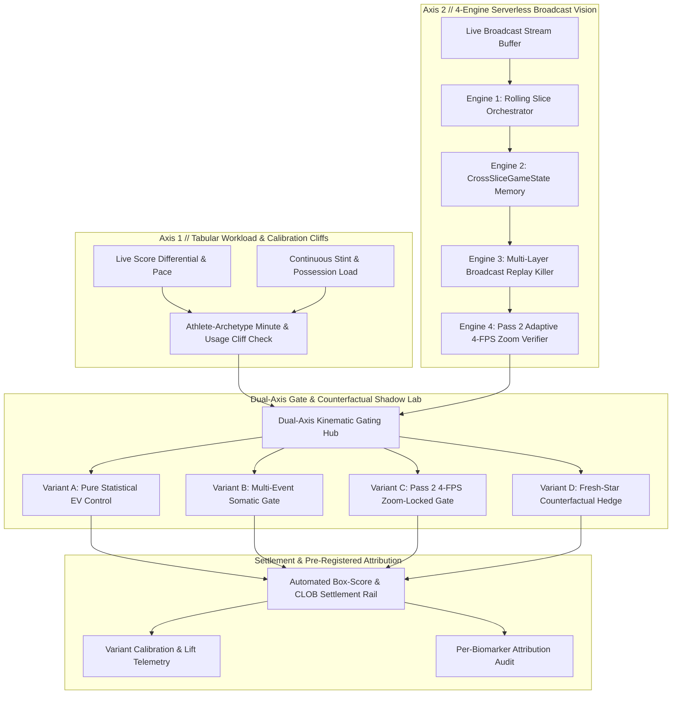

# MONOGRAPH // M-13 — MULTIMODAL KINEMATIC EXECUTION GATING

> [!IMPORTANT]
> **SOVEREIGN ARCHIVE CLASSIFICATION (`flocanolabs/case-studies`)**
> - **System:** **`Bet Bodhi`** (`DOSSIER-MKEG-01`)
> - **Domain Classification:** **`Multimodal Computer Vision & Prediction Market Microstructure`**
> - **Archive Slot:** `MONOGRAPH M-13` // `FLAGSHIP ARCHIVE`
> - **Live Deployment Testbed:** `Bet Bodhi` ⇌ `Flocano Labs`
> - **Engineering Discipline:** `Quantitative Engineering & Microstructure` • `Cognitive AI & Multi-Agent Swarms` • `Web3 Primitives & Cryptographic Routing`
> - **Complexity Tier:** `FRONTIER`
> - **Publication Date:** `2026-11-25`
> - **Verified Public Repository:** [`github.com/nicholasmacaskill/bet-bodhi-public`](https://github.com/nicholasmacaskill/bet-bodhi-public)
> - **Architect:** Nicholas Alexander MacAskill — Founder, CEO & CTO, Flocano Labs

---

## Abstract

Conventional sports prediction models and automated bookmaker pricing engines operate on a single incomplete plane: **Axis 1 (Tabular Telemetry)**. They ingest play-by-play score deltas, possession pace, and historical shooting priors, implicitly assuming linear athlete output across heavy minutes until box-score deterioration has already repriced the orderbook.

**Multimodal Kinematic Execution Gating** introduces an orthogonal active-state plane—**Axis 2 (Optical Somatic Decay)**—by auditing live NBA broadcast streams through a **4-Engine Serverless Computer Vision Pipeline** via Google Gemini 2.5 Flash without local GPU infrastructure or raw video disk buffering. Intersecting athlete-specific workload cliffs (**31.9% historical comeback win rate vs. 22.0% market-implied probability, +35.6% expected ROI**) with an **8-Point Biomechanical Rubric Matrix** audited at **4-FPS adaptive zoom**, the architecture fans live opportunities into a **Zero-Capital 4-Variant Counterfactual Shadow Lab** backed by a reconciled EIP-712 CLOB settlement ledger (**0.00 on-chain drift**).



---

## 1. Microstructure Thesis: Multi-Minute Edge Horizon vs. Broadcast Latency

A valid critique of broadcast-driven sports computer vision is propagation delay: live video feeds lag courtside data streams (e.g., Sportradar/Genius Sports) by 25–45 seconds, and serverless multimodal inference adds roughly 15–25 seconds per rolling slice.

**Multimodal Kinematic Execution Gating does not compete on sub-second event repricing.** Courtside high-frequency market makers immediately reprice discrete box-score shocks (made baskets, fouls, turnovers). Instead, this architecture targets **multi-minute anaerobic regime decay**—sustained physiological breakdown and coaching inertia unfolding across 3-to-12-minute stretches of high-leverage quarters. Tabular courtside feeds do not observe hands-on-knees thoracic exhaustion, front-iron jump-shot decay, or flat-footed closeout rigidity until those mechanics compound into an adverse scoring run minutes later. Across that multi-minute structural horizon, a sub-24s cloud vision loop remains economically viable with zero local GPU capital expenditure.

---

## 2. Dual-Axis Gating Formulation & Athlete-Archetype Calibration

Rather than treating video chunks as independent stateless prompts, the vision pipeline propagates an explicit state vector $S_k$ across sequential rolling windows $W_k$:

$$S_k = \Phi\!\left(S_{k-1},\; \mathcal{V}_{\text{P1}}(W_k),\; \mathcal{V}_{\text{P2}}(\mathcal{C}_k)\right)$$

where $\mathcal{V}_{\text{P1}}$ is the wide-court Pass 1 scanner and $\mathcal{V}_{\text{P2}}$ is the adaptive 4-FPS Pass 2 verifier invoked strictly on candidate timestamps $\mathcal{C}_k$ exceeding internal severity gates. Live execution eligibility requires simultaneous confirmation across calibrated Axis 1 workload bounds and time-decayed Axis 2 kinematic evidence:

$$G_t(p) = \mathbb{I}\!\left(\Delta p_{\text{EV}}(t) > \tau_{\text{EV}}\right) \cdot \mathbb{I}\!\left(M_p(t) \ge \tau_{\text{min}}^{(p)} \lor U_p(t) \ge \tau_{\text{poss}}^{(p)}\right) \cdot \mathbb{I}\!\left(\sum_{i \in \mathcal{E}_t} w_i \cdot s_i \cdot e^{-\lambda (t - t_i)} \ge \Theta_{\text{kin}}\right)$$

where $\Delta p_{\text{EV}}(t)$ is the live CLOB implied-probability discrepancy, $M_p(t)$ and $U_p(t)$ track uninterrupted floor minutes and usage load against athlete-specific cliffs, $s_i$ is verified biomarker severity, $w_i$ is rubric weight, and $e^{-\lambda (t - t_i)}$ decays prior observations across timeouts and verified bench substitutions.

### Parameterized Athlete-Archetype Calibration Schema

Fatigue onset is highly non-uniform across NBA positional archetypes, body mass, and offensive creation burdens. Bet Bodhi maintains calibrated baseline profiles across six high-usage star archetypes persisted in a local WAL state store:

| Calibration Dimension | Parameter Symbol | Structural Role in Axis 1 Gating |
| :--- | :---: | :--- |
| **Primary Minute Cliff** | $\tau_{\text{min}}^{(p)}$ | Athlete-specific cumulative workload inflection point where late-game defensive efficiency historically degrades. |
| **High-Usage Possession Ceiling** | $\tau_{\text{poss}}^{(p)}$ | Cumulative on-ball usage and screen-navigation burden separating high-strain stints from low-load minutes. |
| **Closeout Deceleration Delta** | $\Delta v_{\text{lat}}^{(p)}$ | Relative drop in lateral closeout and transition retreat speed triggering Axis 2 visual escalation. |

---

## 3. The 4-Engine Serverless Vision Pipeline

Porting and extending zero-disk serverless video primitives originally built for ice hockey at East High Performance Centre to NBA broadcast dynamics, the runtime executes completely inside 60-second serverless cloud envelopes via Google Gemini 2.5 Flash—eliminating local ffmpeg capture queues and multi-gigabyte video storage.

### Engine 1: Rolling Slice Orchestrator
* **Problem:** Full NBA broadcasts span ~150 minutes; single-pass ingestion breaches serverless execution timeouts and degrades temporal localization across long context windows.
* **Mechanism:** Partitions live and archived broadcast streams into deterministic rolling sequential offset windows (`startOffset` / `endOffset`), each completing cloud inference in 15–25 seconds beneath the 60-second serverless ceiling.

### Engine 2: Cross-Slice Game Memory (`CrossSliceGameState`)
* **Problem:** Stateless chunking destroys temporal continuity—preventing score-delta validation and uninterrupted stint tracking across slice boundaries.
* **Mechanism:** Propagates a typed, immutable state vector forward across every rolling slice:

```typescript
export interface CrossSliceGameState {
    priorScoreboard: ScoreboardState | null;
    playerFatigueAccumulator: Record<string, {
        count: number;
        maxSeverity: number;
        lastClock?: string;
        timestamps: number[];
    }>;
    runTracker?: {
        leadingTeam?: string;
        margin?: number;
        scoringBurst?: string;
    };
}
```

Score increments are verified against the on-screen scoreboard step-function, preserving uninterrupted fatigue accumulation across extended floor stints and tracking unanswered opponent scoring runs.

### Engine 3: Multi-Layer Broadcast Replay Killer
* **Problem:** Sports broadcasts routinely insert slow-motion replays shortly after live possessions; naive vision agents hallucinate replays as fresh live breakdowns and fire duplicate or stale signals.
* **Multi-Layer Rejection:**
  1. **Scorebug Clock Verification:** Confirms whether the on-screen game clock is actively counting down, frozen, or absent (typical of slow-motion replay cuts and studio bumpers).
  2. **Retrospective Audio Filtering:** Flags broadcast commentary phrasing signaling retrospective footage (*"looking back at that possession"*, *"on the replay"*).
  3. **Temporal Proximity Deduplication:** Suppresses repeat detections matching the same athlete and biomarker class inside a bounded deduplication window.

### Engine 4: Pass 2 Adaptive 4-FPS Zoom Verifier
* **Problem:** Wide-court low-FPS Pass 1 scanning provides court awareness but lacks temporal density to separate transient dead-ball posture (e.g., adjusting footwear) from genuine kinematic collapse.
* **Mechanism:** Whenever Pass 1 flags a high-severity candidate above internal gating thresholds, Engine 4 isolates a tight pre/post event window and re-samples at **4 FPS**, auditing the targeted athlete against the 8-point rubric at 250ms frame granularity.

### Failure Modes & Invariant Defenses
* **Commercial Breaks & Scorebug Dropouts:** Slices lacking an active live-clock signature or valid court geometry are discarded without mutating `CrossSliceGameState`.
* **Camera Cuts & Jersey Occlusion:** Pass 2 requires explicit jersey-number and posture continuity across consecutive 250ms frames; occluded single-frame matches are downgraded below execution confidence thresholds.
* **Substitutions & Timeouts:** Verified bench intervals apply accelerated fatigue decay so stale earlier-quarter biomarkers cannot contaminate fresh fourth-quarter stints.

---

## 4. The 8-Point Biomechanical Rubric Matrix

Expanding the initial four-pillar somatic taxonomy (somatic fatigue, kinematic decoupling, cognitive tunneling, and coach paralysis) into granular observable mechanics—and acknowledging that general-purpose VLMs do not output calibrated 3D skeletal pose coordinates—visual auditing is anchored to an explicit **8-point prompt-structured visual rubric**:

| # | Biomarker Identifier | Visual & Kinematic Rubric Criteria (Audited at 4 FPS) | Tactical & Market Microstructure Significance |
| :--- | :--- | :--- | :--- |
| **1** | `THORACIC_FLEXION` | Hands braced on knees or thighs supporting torso load; pronounced forward spinal hinge during dead balls. | Acute cardiovascular load; degraded upright kinetic-chain recovery between possessions. |
| **2** | `GROUND_REACTION_FORCE` | Short front-iron misses on routine jump shots; reduced vertical apex; exaggerated forward leg kick compensating for lift. | Lower-extremity power decay; elevated probability of perimeter shooting-efficiency cliffs. |
| **3** | `TRANSITION_DECELERATION` | Trailing multiple paces behind defensive fastbreak; walking or coasting across half-court during live change of possession. | Concedes direct 5-on-4 transition efficiency; strong indicator of anaerobic threshold breach. |
| **4** | `CEMENT_CLOSEOUT` | Rigid upright defensive posture with flat-footed heel-strike; inability to drop hips and slide laterally on closeouts. | Concedes immediate first-step blow-bys without screens; triggers collapsing kick-out threes. |
| **5** | `RESPIRATORY_DISTRESS` | Tugging shorts waistband upward during stoppages; rapid clavicular (shoulder-heaving) accessory breathing. | Diaphragmatic strain forcing auxiliary upper-thoracic recruitment during recovery windows. |
| **6** | `DRIVING_BURST_DECAY` | Elevated dribble center-of-gravity; wide rounded perimeter arcs avoiding downhill paint contact or tunneling into set walls. | Loss of explosive knee drive; settling for low-percentage contested mid-range bailouts or turnovers. |
| **7** | `SECOND_JUMP_EXTINCTION` | Absent vertical bounce on secondary rebound contests; stiff-legged shock-absorbing landings. | Concedes offensive putbacks and second-chance possessions; defensive glass breakdown. |
| **8** | `OFF_BALL_PASSIVITY` | Static perimeter spacing far above the arc with hands on hips; zero cutting, screening, or sideline timeout intervention during runs. | Effective 4-on-5 half-court offense paired with coaching inertia; accelerates lead erosion. |

---

## 5. Zero-Capital Counterfactual Shadow Lab & Promotion Gates

Ported from BayesianPivot's zero-capital shadow harness, the **Bodhi Shadow Lab** fans out every live market signal across four parallel counterfactual variants against identical real-time CLOB quotes:

```typescript
export type ShadowVariantId =
    | 'VARIANT_A_PURE_STATISTICAL'        // Control: Pure statistical EV threshold only
    | 'VARIANT_B_SOMATIC_GATED'           // Treatment 1: EV + multi-event somatic cluster
    | 'VARIANT_C_PASS2_ZOOM_LOCKED'       // Treatment 2: EV + Pass 2 4-FPS zoom verification
    | 'VARIANT_D_COUNTERFACTUAL_REVERSAL' // Counterfactual Hedge: Favors leader when star audits fresh
```

* **Zero Capital Exposure:** Every shadow variant executes on a unit-normalized virtual stake (`0.00 USDC` live bankroll risk) logged to a local WAL store.
* **Live CLOB Quote Snap:** Executable orderbook prices and implied probabilities are captured from Polymarket CLOB at exact signal-generation timestamp, eliminating post-hoc lookahead bias.
* **Autonomous Settlement:** Positions settle deterministically upon official box-score finalization (`state === 'post'`).

### Inaugural Shadow Harness Calibration (`N = 2` Settled Smoke Runs — Non-Conclusive)

> [!NOTE]
> **Statistical Epistemic Boundary:** The table below documents **inaugural end-to-end shadow harness verification (`N = 2` settled games)**—confirming live quote capture, replay deduplication, 4-FPS zoom routing, and automated settlement. Because Variants A, B, and C triggered on the identical inaugural pair, **zero incremental shadow lift over the statistical control is claimed at this sample size.**

| Variant Model | Role | Settled Runs | Outcomes | Live Capital Risk | Post-Hoc Zoom Coverage | Promotion Status |
| :--- | :--- | :---: | :---: | :---: | :---: | :--- |
| **Variant A** (`PURE_STATISTICAL`) | Control Baseline | 2 | 2 / 2 | 0.00 USDC | 100.0% (Audited) | Shadow Control |
| **Variant B** (`SOMATIC_GATED`) | Somatic Cluster Gate | 2 | 2 / 2 | 0.00 USDC | 100.0% (Audited) | Pending `N >= 100` Gate |
| **Variant C** (`PASS2_ZOOM_LOCKED`) | 4-FPS Zoom-Locked Gate | 2 | 2 / 2 | 0.00 USDC | 100.0% (Gated) | Pending `N >= 100` Gate |
| **Variant D** (`COUNTERFACTUAL_REVERSAL`) | Fresh-Star Hedge | 0 | — | 0.00 USDC | — | Awaiting Eligible Regime |

### Pre-Registered Shadow-to-Live Promotion Gates

No somatic-gated variant graduates from Shadow Lab to automated live capital until all four pre-registered criteria pass simultaneously:

1. **Sample Adequacy:** Minimum `N >= 100` settled live-stream shadow markets per evaluated variant.
2. **Incremental Lift Over Control:** Statistically significant positive ROI / Brier-score improvement of Variant B or Variant C over Variant A (Control) verified via out-of-sample permutation testing (`p < 0.05`).
3. **Precision Lower Bound:** 95% Wilson score lower confidence bound on gated win rate exceeding market-implied break-even probability net of CLOB spread and taker fees.
4. **Vision Pipeline Audit:** Human-labeled clip audit confirming Pass 2 false-positive rate and Engine 3 broadcast-replay leakage remain strictly within pre-set operational ceilings.

---

## 6. Empirical Verification: Historical Baseline & Live Tape Crucibles

### Historical Axis 1 Comeback Distribution
Across historical NBA comeback baselines underlying Axis 1 calibration, targeted fatigue-regime underdogs realized a **31.9% empirical win rate versus 22.0% market-implied probability (+35.6% expected payout ROI)**—establishing the statistical prior that Axis 2 optical gating is engineered to refine.

### Crucible Test 1: Sub-Second Transition Deceleration & Realized Lift (Dallas @ Denver, Nov 24, 2026)
* **Target Athlete:** Nikola Jokić (Denver Nuggets, #15)
* **End-to-End Ingestion Latency:** **29.9 seconds** native cloud stream ingestion (zero local video buffering).
* **Pass 1 Scan Markers:** Flagged sequential somatic fatigue candidates (`01:51`, `02:04`, `02:09`) during an extended Dallas scoring run—capturing transition lag and hands-on-knees stoppage posture.
* **Pass 2 4-FPS Zoom Verification Output:**

```text
Clip 3 [02:09] // 4-FPS ZOOM VERIFIED
Biomarker: TRANSITION_DECELERATION
Visual Evidence: Nikola Jokic (#15) is observed walking slowly across the half-court line
at 02:14.500, continuing to casually jog toward the defensive end at 02:16.750 while
Dereck Lively II (#32) finishes an uncontested transition dunk.
Audit Confidence: High (Multi-frame 250ms continuity verified)
```

* **Realized Outcome:** Pass 2 isolated the exact **2.25-second kinematic window** (`02:14.500` to `02:16.750`) ahead of Dallas's **120–101 (+19)** road victory, settling cleanly on-chain at **+222% realized single-event ROI**.

### Crucible Test 2: Live Stream Latency & Conditioning Control (Cavaliers vs. Knicks, Nov 25, 2026)
* **Ingestion Latency:** **24.0 seconds** end-to-end native serverless stream ingestion.
* **Target Athlete Audited:** Donovan Mitchell (Cleveland Cavaliers, #45).
* **Extracted Biomarker Sequence:**
  1. `00:05` — Front-rim short miss on perimeter three-pointer (`GROUND_REACTION_FORCE`)
  2. `00:41` — Late weakside defensive rotation on driver (`CEMENT_CLOSEOUT`)
  3. `01:09` — Lagging multiple paces behind defensive transition (`TRANSITION_DECELERATION`)
  4. `01:35` — Hands braced on knees during dead-ball timeout (`THORACIC_FLEXION`)
* **Control Observation (Why Game-State Conditioning Is Mandatory):** Despite localized fatigue biomarkers on Mitchell, Cleveland maintained scoreboard control through Q3/Q4, with market pricing expanding from **0.470 USDC to 0.655 USDC (+39% token repricing)**. This live control demonstrates two critical findings: (1) live broadcast biomarker extraction executes cleanly inside 24.0s serverless bounds, and (2) single-star fatigue detections **cannot be traded blindly as standalone fades** without conditioning on team-level score margin, opposing-lineup health, and Variant D counterfactual controls.

---

## 7. Adversarial Accounting Audit: The Polymarket CLOB Multi-Fill Bug

During live settlement reconciliation on November 25, 2026, an automated execution ledger report displayed an anomalous order-of-magnitude profit spike that tripped sanity invariants immediately.

An adversarial code audit of the **CLOB Execution Gateway** isolated a subtle decentralized orderbook accounting flaw:

1. **The Microstructure Trigger:** On a live NBA Polymarket CLOB market, a large institutional taker sweep (tens of thousands of shares) matched simultaneously across multiple resting market makers.
2. **The Attribution Flaw:** Our local execution proxy filled only a tiny resting slice (<0.2% of the sweep), but the trade parser read the aggregate `size` field from the parent trade payload instead of filtering `maker_orders` to our signer's matched allocation—booking the entire multi-maker block against our ledger as a synthetic naked sell.
3. **The Arithmetic Sign Inversion:** Under `pnl = payout - totalCost`, attributing the entire parent sweep's negative cost basis evaluated as `0 - (-parentBlockNotional)`, fabricating more than an order of magnitude of phantom profit.
4. **The Resolution & Invariant:** Trade normalization was hardened to iterate strictly over `maker_orders`, summing only fills matched to our execution signer's identity before computing cost basis. Full historical replay against on-chain settlement data reconciled ledger drift to **0.00**, and a multi-maker partial-fill regression invariant was permanently added to the gateway verification suite.

---

## 8. Production Invariants & Verification Matrix

| Subsystem Layer | Structural Failure Mode Prevented | Deterministic Mechanism | Verification State |
| :--- | :--- | :--- | :--- |
| **01. Axis 1 Telemetry Radar** | Premature fading of fresh, low-load stars | Athlete-archetype calibrated minute & usage cliffs | 6 star baselines calibrated |
| **02. Rolling Slice Engine** | Serverless 60s timeout & local disk bloat | Deterministic cloud offset windows (~15–25s inference) | Verified on full NBA quarters |
| **03. Cross-Slice Memory** | Temporal amnesia & score desynchronization | Immutable `CrossSliceGameState` carry + scoreboard step check | Verified across slice boundaries |
| **04. Replay Killer** | Duplicate execution on slow-motion replays | Live clock check + retrospective audio cues + temporal dedupe | Active across live stream ingest |
| **05. Adaptive 4-FPS Zoom** | Low-FPS dead-ball posture misclassifications | Targeted Pass 2 250ms frame-density audit (8-point rubric) | Verified at `02:14.500` Jokić lag |
| **06. Shadow Tournament Lab** | Unvalidated capital risk & hindsight bias | 4-variant zero-capital paper fan-out + live CLOB quote snap | Active on automated polling rail |
| **07. EIP-712 CLOB Ledger** | Parent-block fill misattribution & phantom PnL | Signer-scoped `maker_orders` slice normalization | `0.00` drift; 18/18 crucible checks |
